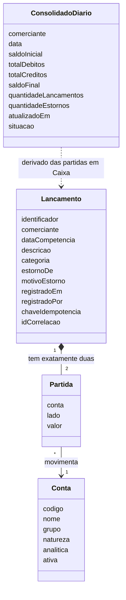

# Modelo de domínio

O domínio tem um agregado com regras fortes, o Lançamento, uma entidade de apoio, a Conta do plano de contas, e uma projeção derivada, o Consolidado Diário da conta Caixa. Esta página aplica ao modelo do handoff as alterações de 20/10/2026 (partidas dobradas, RN-21 a RN-24).

## Agregado Lançamento (fonte da verdade)

| Atributo | Regra |
| --- | --- |
| Identificador | Gerado pelo sistema, único global |
| Comerciante | Vem da credencial, nunca do corpo da requisição (RN-11) |
| Partidas | Exatamente duas: uma a débito e uma a crédito, de mesmo valor, em contas analíticas diferentes, uma delas a conta Caixa (RN-21, RN-24) |
| Valor | Decimal positivo, 2 casas, até o teto da RN-17 |
| Data de competência | Dia de negócio; se omitida, o dia atual (RN-20) |
| Descrição | 3 a 140 caracteres (RN-16) |
| Categoria | Texto controlado, opcional |
| Estorno de, motivo do estorno | Só em estorno |
| Registrado em, registrado por | Data de registro com fuso e usuário autenticado |
| Chave de idempotência | Obrigatória no registro e no estorno (RN-10) |
| ID de correlação | Recebido ou gerado na entrada |

| Código | Invariante |
| --- | --- |
| I-01 | Valor sempre maior que zero; o efeito no saldo vem da natureza da conta e do lado da partida. |
| I-02 | Depois de gravado, nenhum atributo muda. Não há edição nem exclusão. |
| I-03 | O estorno inverte as duas partidas do original: mesmas contas, lados trocados, mesmo valor, mesmo comerciante. |
| I-04 | Um original tem no máximo um estorno, inclusive sob requisições simultâneas. |
| I-05 | Um estorno não pode ser estornado. |
| I-06 | A situação "estornado" do original é derivada da existência do estorno, sem alterar o original. |
| I-07 | Chave de idempotência é única por comerciante durante a janela de retenção. |
| I-08 | Em todo lançamento, a soma dos débitos é igual à soma dos créditos. |
| I-09 | Partida só existe em conta analítica ativa do plano do próprio comerciante. |

## Entidade Conta (plano de contas)

| Atributo | Regra |
| --- | --- |
| Grupo | Ativo, Patrimônio Líquido, Receitas ou Despesas; fixos para todos os comerciantes (RN-22) |
| Natureza | Devedora em Ativo e Despesas, credora em Patrimônio Líquido e Receitas (RN-23) |
| Analítica | Só conta analítica recebe partida; os grupos são sintéticos |
| Ativa | Conta inativa deixa de receber partida nova; o histórico permanece |

A conta Caixa, analítica do grupo Ativo, existe para todo comerciante.

## Projeção Consolidado Diário (dado derivado)

É a projeção da conta Caixa por comerciante e dia de competência (RN-06). Débito em Caixa aumenta o saldo; crédito reduz.

| Código | Invariante |
| --- | --- |
| C-01 | Saldo final = saldo inicial + débitos em Caixa - créditos em Caixa, em todo dia. |
| C-02 | Saldo inicial do dia D = saldo final do dia D-1, sem lacuna. |
| C-03 | Passado o atraso máximo, o saldo final de D é igual ao saldo da conta Caixa calculado direto de todos os lançamentos até D. |
| C-04 | Cada evento altera a projeção no máximo uma vez, qualquer que seja a ordem de chegada. |
| C-05 | O Consolidado nunca é fonte para decisão de escrita em Lançamentos. |

## Ciclo de vida

O lançamento nasce registrado e permanece assim. Se houver estorno, a leitura o apresenta como estornado, com o vínculo para o estorno. Não há outros estados.
