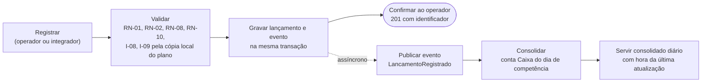

# Em que momento o comerciante sabe que o lançamento está garantido?

Na confirmação do registro, que acontece depois da gravação e antes de qualquer consolidação. Tudo à direita desse ponto pode atrasar sem que o lançamento se perca.

| Etapa | Domínio | Se falhar |
| --- | --- | --- |
| Validar | Lançamentos | O operador recebe o erro com a regra violada; nada é gravado |
| Gravar | Lançamentos | O operador recebe erro e repete com a mesma chave de idempotência; não há duplicidade (RN-10) |
| Confirmar | Lançamentos | Ponto de garantia: a partir daqui o lançamento existe e o evento vai sair |
| Publicar | Lançamentos | O evento já está gravado junto com o lançamento e sai quando a publicação voltar (ADR-0002) |
| Consolidar | Consolidado Diário | Os eventos aguardam; o saldo atrasa e converge quando o Consolidado volta (NFR 1) |
| Servir | Consolidado Diário | A leitura falha e o integrador repete; é aqui que valem os 5% do NFR 2 |
