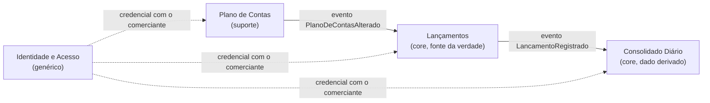

# Como o Consolidado fica sabendo de um lançamento?

Só por evento. Nenhuma seta volta do Consolidado para o Lançamentos, e o Lançamentos não chama o Plano de Contas para registrar (C-05, RNF-01).

| Relação | Tipo | O que trafega | O que acontece se o upstream cair |
| --- | --- | --- | --- |
| Plano de Contas para Lançamentos | Upstream e downstream, por evento | Conta criada, alterada ou inativada | O Lançamentos segue validando partidas pela cópia local do plano |
| Lançamentos para Consolidado | Upstream e downstream, por evento | Lançamento registrado, incluindo estorno, com as duas partidas | Não se aplica: sem Lançamentos não há fato novo a consolidar |
| Identidade para os três | Genérico, por credencial | Usuário, perfil e comerciante | Novas autenticações falham; nenhum serviço aceita chamada anônima |

O Consolidado cair não afeta ninguém a montante: os eventos aguardam e são aplicados quando ele volta.
